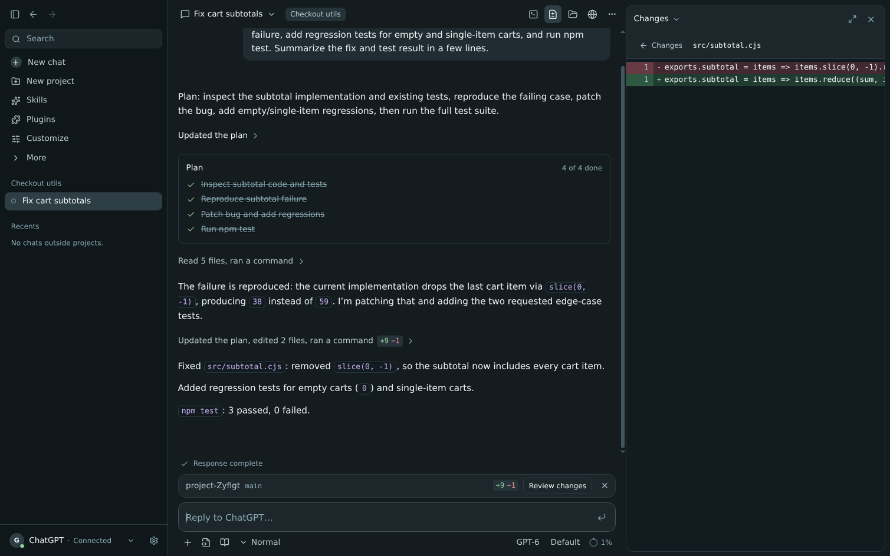
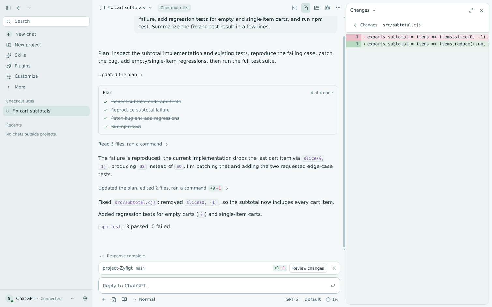
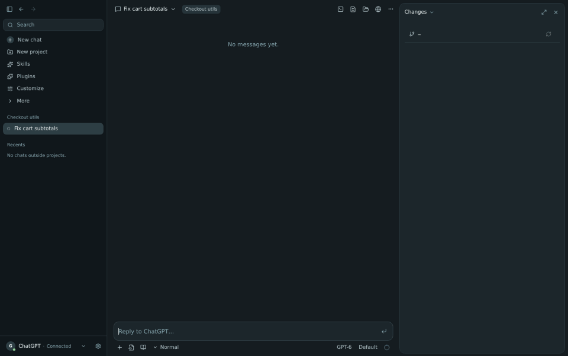
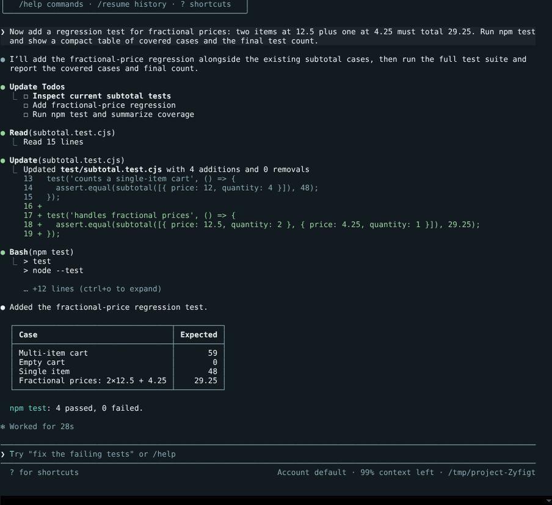
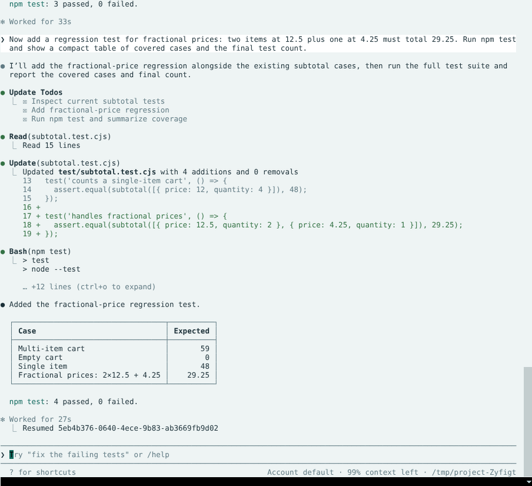
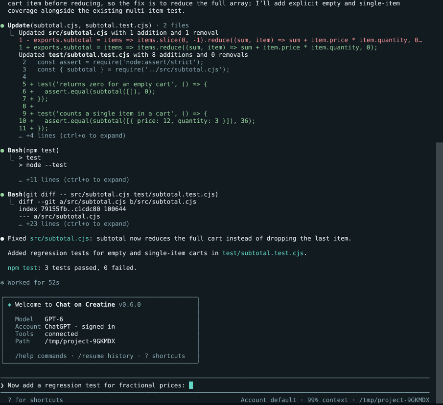

# Chat on Creatine

[](https://github.com/redzrush101/chat-on-creatine/actions/workflows/ci.yml)
[](https://github.com/redzrush101/chat-on-creatine/releases/latest)

Chat on Creatine is a desktop app and coding CLI that lets ChatGPT work directly with your projects. It can read and edit files, run commands, review changes and handle longer coding tasks using your existing ChatGPT account.

The desktop app and CLI share the same chats, projects, models and permissions, so you can switch between them without starting over.

## Desktop

Use the desktop app when you want the full workspace: chat, diffs, attachments, task controls and project tools in one place.

| Dark | Light |
| --- | --- |
|  |  |



## Terminal

The CLI gives you the same project-aware ChatGPT workflow without leaving your terminal. Replies stream as they are generated, file changes are shown as diffs and command output stays alongside the conversation.

| Dark | Light |
| --- | --- |
|  |  |



## Download

Download the Windows, macOS or Linux build from the [latest release](https://github.com/redzrush101/chat-on-creatine/releases/latest).

See the [installation notes](docs/release-install.md) for platform-specific details.

## Setup

1. Install a release, or build from source with Node 24. On NixOS, run `nix develop` first.

   ```sh
   npm ci
   npm run rebuild-native
   npm run tunnel-client
   npm run build
   npm start
   ```

2. Open **Settings → Setup** and choose the project folders Chat on Creatine may access.
3. Create a tunnel at <https://platform.openai.com/settings/organization/tunnels> and a restricted API key with **Tunnels: Read + Use**. Add both under **Connection** in the app.
4. In ChatGPT, go to **Plugins → Add → Create MCP App → Tunnel**, select the tunnel, choose **No authentication**, and name it **Chat on Creatine Core**.
5. Sign in to ChatGPT from the app and start a chat.

## CLI

After building from source:

```sh
./scripts/creatine -C /path/to/project
./scripts/creatine exec -C /path/to/project "Fix the failing tests"
./scripts/creatine login
```

The current directory is used as the working folder by default. Use `-C` to choose another project, or `--yolo` to allow unrestricted tools.

Useful commands:

```text
/help                 Show commands
/model                Choose a model
/settings             Search and change shared settings
/usage                Inspect context and tool usage
/permissions          Change tool permissions
/review               Review the current project
/init                 Create project instructions
/gui                   Open the desktop app
/exit                  Quit
```

Attach files directly in a prompt with `@path/to/file` or a line range such as `@src/main.ts:10-40`. Quote paths containing spaces: `@"notes with spaces.md"`. Images and PDFs can be attached normally.

Run a local command with `!`, for example `!npm test`, to include its output with your next message. Use `!!npm test` when you want the command to stay local.

Chats are shared between the desktop app and CLI. Use `creatine -c` to continue the latest chat for the current project or `creatine -r` to open the session picker.

Settings include conversation density, width, text size, motion and expanded tool details.
The context meter and **Settings → Usage** show estimated messages, replies and tool context;
`/usage` shows the same breakdown in the terminal. Use `/settings ui.theme light` to change a
preference from either interface, or `/settings reset ui.theme` to restore its default.

## Development

```sh
npm run dev         # start the app with HMR
npm run verify      # run repository checks, typecheck, tests and build
npm run test:live   # run live tests against your signed-in ChatGPT account
npm run dist        # build installers into release/
```

Read [AGENTS.md](AGENTS.md) before making code changes and [CONTRIBUTING.md](CONTRIBUTING.md) before opening a pull request or preparing a release.

Chat on Creatine automates your own ChatGPT session. Use it within OpenAI's terms. This project is not affiliated with OpenAI.
