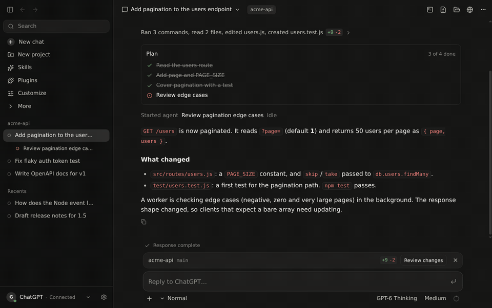
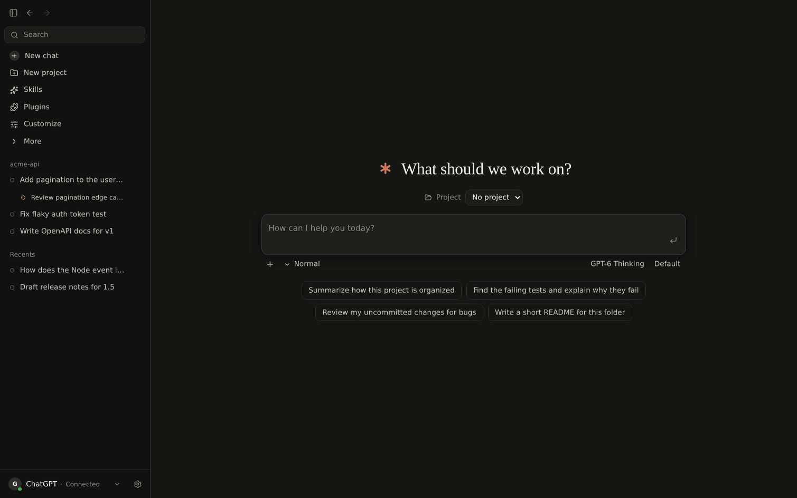

# Chat on Creatine

[](https://github.com/redzrush101/chat-on-creatine/actions/workflows/ci.yml)
[](https://github.com/redzrush101/chat-on-creatine/releases/latest)

A desktop workspace that lets ChatGPT work on your computer: it reads and edits files, runs commands in a real
shell, plans, spawns worker chats, and keeps going on long tasks — while ChatGPT itself (your account, your plan)
does the thinking. A clean rewrite of Chat On Steroids.



Tool calls fold into one line per run that opens into the exact commands, output and line-numbered diffs. Agents,
commands, changes, files and a terminal sit in the side panel; the composer shows the branch and its change totals.

| Dark | Light |
| --- | --- |
|  |  |



## How it works

```
ChatGPT (built-in browser or your Chrome + companion extension)
   │  page driver: reads the conversation stream, types and sends messages
   ▼
Electron main ── router ── sessions / outbox / recorder ── Goal·Loop / workers / Compact & Resume
   ▲
   │  MCP over OpenAI's Secure MCP Tunnel (or cloudflared / your own HTTPS)
Local MCP server: Core (files, patches, terminal, plans, workers) · Desktop (browser control) · Plugins (your MCP servers)
```

- ChatGPT runs in the app's own browser (persistent profile); a small driver observes the native conversation stream
  (`/backend-api/f/conversation`) instead of scraping the DOM, so history, tool calls and turn ends are exact.
- Tool calls are attributed to the chat that made them via the request id ChatGPT puts on both the MCP request and the
  streamed message.
- Approved folders bound every file tool; commands run with your normal user rights (optional allow/deny policy).

## Download

Get the installer for Windows, macOS or Linux (x64 and arm64) from the
[latest release](https://github.com/redzrush101/chat-on-creatine/releases/latest). The builds are
unsigned; the release notes explain the one-time step each system asks for.

## Setup

1. Install a release, or build and start from source (NixOS / nix):
   ```sh
   nix develop
   npm ci && npm run rebuild-native && npm run tunnel-client
   npm run build && npx electron .
   ```
   Without nix: Node 24 and Electron 44; skip the nix shell.
2. **Settings → Setup**: approve a project folder.
3. **Connection**: create a tunnel in <https://platform.openai.com/settings/organization/tunnels> and a restricted API key
   with *Tunnels: Read + Use*; enter both and press **Connect**.
4. In ChatGPT: **Plugins → Add → Create MCP App → Tunnel**, pick the tunnel, *No authentication*, name it exactly
   **Chat on Creatine Core**.
5. **Sign in to ChatGPT** in the app's ChatGPT window, pick a model, send.

## Development

```sh
npm run dev         # electron-vite with HMR
npm run verify      # repository rules, typecheck, tests, build
npm run build:extension   # companion extension for the Chrome host
npm run dist        # installers for this platform into release/ (after npm run tunnel-client)
```

Read [AGENTS.md](AGENTS.md) before changing code, and [CONTRIBUTING.md](CONTRIBUTING.md) for
pull requests and releases.

Code map: `src/shared` contracts · `src/main/mcp` server + tools · `src/main/chatgpt` hosts + router ·
`src/page` in-page driver · `src/main/sessions` history/outbox/recorder · `src/main/{agents,automation}` workers,
Goal/Loop, Compact & Resume · `src/main/tunnel` connection · `src/renderer` React UI.

Use it within OpenAI's terms; it automates your own ChatGPT session and is not affiliated with OpenAI.
